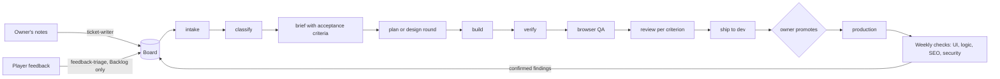

# Swish Quest

**Play it live: [swishquest.com](https://swishquest.com)**

A web app of short NBA trivia minigames: guess the playoff series winner, name the MVP, fill in a starting five,
solve the daily Wordle, trace a career path, play Tic-Tac-Toe on player criteria, earn points, climb a leaderboard, and
play head-to-head against a friend or a stranger online. 11 games are playable today and 7 more are built and held
back; the roster and what is planned are in [docs/games/MASTER_PLAN.md](docs/games/MASTER_PLAN.md).

Frontend: React 19, TypeScript, Next.js 16, Tailwind 4. Backend: Django and Django REST Framework on Postgres.
Multiplayer: a Node Socket.IO server. Data: [`nba_api`](https://pypi.org/project/nba_api/).

---

## Built and operated with AI agents

This repository is run as an AI-native project: most changes are specified by a person and planned, built, tested,
reviewed and checked by Claude agents, with scripts doing everything mechanical and a person deciding what reaches
production. The whole layer is indexed in **[`.claude/README.md`](.claude/README.md)**.

| | Where | What is there |
|---|---|---|
| **Agents** | [`.claude/agents/`](.claude/agents/) | 18 roles, each with its model and instructions: planner, frontend and backend engines, browser QA, code and motion reviewers, ticket writer, feedback triage, the UI-check judges, logic-check triage, the SEO agent, and the question team. |
| **Skills** | [`.claude/skills/`](.claude/skills/) | 17 procedures an agent or a session follows: the pipeline run, classify, design round, ship, UI check and fix, logic check, SEO, ticket intake, feedback triage, question writing, promotion. |
| **Automations** | [`.github/workflows/`](.github/workflows/) and [`scripts/`](scripts/README.md) | 28 workflows and the scripts behind them: the team pipeline, weekly production checks, the security gate, SEO audits, data refresh and publishing. |
| **Model policy** | [`.claude/models.json`](.claude/models.json) | Which Claude model does what, in one checked file: Fable 5.2 where a wrong call is expensive, Opus 5.5 for judgment, Sonnet 5.5 as the default worker, Haiku 5.5 for trivial edits. |
| **AI in the product** | [`backend/trivia/game_builder/`](backend/trivia/game_builder/) | An admin describes a game in plain words and an agent builds a playable one from the datasets. |

### What the agents do

- **The team pipeline** turns a card on a Notion board into a commit on `dev`: intake, classify, one generated
  brief per card, a plan (or a written design round for hard cards), build, a scripted verify gate, browser QA,
  and a clean-context review that returns a verdict for every acceptance criterion. Up to two cards run at once.
  Operator manual: [docs/team/PIPELINE.md](docs/team/PIPELINE.md).
- **Ticket intake** splits a long brain-dump into separate cards, and refuses any ticket without acceptance
  criteria someone can check.
- **Feedback triage** reads what players wrote in the feedback form, groups repeat reports and files cards for
  what is actionable. Those cards land in Backlog: text from the public never starts work by itself.
- **Weekly production checks** play every game on seven viewports and exercise the API and the socket protocol;
  judge agents turn failures into probe-confirmed findings, and findings become cards the pipeline fixes
  ([UI check](docs/ui-check/README.md), [Logic Check](docs/logic-check/README.md)).
- **The security agent** scans the full repository weekly and gates every pull request to `main`, fixing what it
  can through the pipeline ([docs/security/README.md](docs/security/README.md)).
- **The SEO agent** audits indexing weekly and after every deploy ([docs/seo/README.md](docs/seo/README.md)).
- **The question team** (author, checker, doctor, reviewer) can propose, fact-check and repair trivia questions.
  It is dormant by choice; questions are currently written with the owner in the session.
- **The AI game builder** is the same idea inside the product: an admin describes a game, a Claude Opus tool loop
  picks the dataset, writes a declarative spec, test-runs it with the real engine and hands in a playable game,
  which follow-up prompts refine. An admin can approve a game onto a link-only public page.
- **"Why?" explanations** tell a player why a missed answer was wrong: written once per question from the site's
  own data, rejected in code if they state a number that data does not contain, then served from the database.
- **The pipeline measures itself.** Every shipped card's commit carries what it cost (models, tokens, fix rounds),
  read back by a report and an HTML dashboard, and the model that routes cards is chosen by an eval with an
  owner-verified answer key, not by a price list.



### How it stays safe

- Scripts own every write (git, the board, Slack, the database). An agent is spawned only where a decision is
  needed, and agents that read untrusted text get read-only tools and no credentials.
- The pipeline stops at `dev`. Production is a person's decision, behind a required security status.
- Automations that cost money or touch production data start manual-only, and player-facing AI ships dark: the
  model-backed features are off until the owner installs the SDK, sets a key and flips a flag, and until then the
  public site renders exactly as before. `npm run check:ai` fails the build when an agent, a skill, a workflow or
  the model registry drift apart.

---

## Repository map

| Path | What is in it |
|---|---|
| `.claude/` | The AI layer: [agents](.claude/agents/), [skills](.claude/skills/), the model registry and its [index](.claude/README.md) |
| `.github/workflows/` | Every automation's trigger: CI, promotion, weekly checks, security, SEO, data, operations |
| `scripts/` | The mechanics behind the agents ([index](scripts/README.md)): `team/` (pipeline), `ui-check/`, `logic-check/`, `check-core/`, `seo/`, `security/`, `feedback/`, plus repo checks and tests |
| `src/` | The frontend: `app/` (routes), `views/` (pages), `Game Renderers/`, `components/`, `motion/`, `store/`, `hooks/` |
| `backend/` | The Django project: `users/` (accounts, ranks, friends, moderation), `trivia/` (game data, questions, awarding, the admin API, the game builder) |
| `multiplayer_server/` | The Socket.IO relay for online matches and friend rooms |
| `moderation_service/` | The profile-photo moderation service |
| `infra/` | Cloudflare Workers and the cloud routine's setup script |
| `docs/` | Architecture, deployment, constraints, the pipeline manual, checker and SEO guides |

---

## Running locally

The app has **three parts**, each in its own terminal — paste each block into a separate shell.
Requires Node.js and Python 3.10+. Make sure ports **8000**, **4000** and **5173** are free first.
Single-player games only need the backend running; **multiplayer needs all three.**

### 1. Backend — Django API (port 8000)
```bash
cd backend
python -m venv venv
venv\Scripts\activate          # Windows  (macOS/Linux: source venv/bin/activate)
pip install -r requirements.txt
pip install -r requirements-pipeline.txt   # only for the NBA data commands and the test suite
python manage.py migrate
python manage.py runserver 8000
```

### 2. Multiplayer server — Socket.IO (port 4000)
```bash
cd multiplayer_server
npm install
npm start
```

### 3. Frontend — Next.js + React (port 5173)
```bash
npm install
npm run dev
```

Then open **http://localhost:5173**.

The frontend reads the backend URL from `.env` (`VITE_BACKEND_URL=http://localhost:8000/api`) and
the socket URL from `VITE_SOCKET_URL` (defaults to `http://localhost:4000`). Local dev needs no
other env vars — the backend falls back to sqlite when `DATABASE_URL` is unset.

`npm run dev` first runs a probe (`scripts/dev-env.mjs`) that checks whether the local backend
and socket server are actually up, and writes a gitignored `.env.local` that falls back to the
deployed production ones if not — see [docs/DEPLOYMENT.md](docs/DEPLOYMENT.md) → Environments.

**Everyday commands** (from the repo root unless noted):
| | |
|---|---|
| Frontend lint | `npm run lint` |
| Frontend typecheck + build | `npm run build` |
| Backend tests | `cd backend && python manage.py test` |
| Backend sanity check | `cd backend && python manage.py check` |

> **Deploying / scaling to production?** See [docs/DEPLOYMENT.md](docs/DEPLOYMENT.md) for the full
> activation runbook (CDN content, Postgres, Redis, env vars) and
> [docs/DATA_PIPELINE.md](docs/DATA_PIPELINE.md) for how game data is refreshed.

---

---

## Documentation map

| Doc | What is in it |
|---|---|
| [.claude/README.md](.claude/README.md) | Every agent, skill and automation, the model policy, and how to add one |
| [docs/team/PIPELINE.md](docs/team/PIPELINE.md) | Operating the autonomous team pipeline: the board, triggers, gates, model policy, check cards, ticket intake |
| [docs/ARCHITECTURE.md](docs/ARCHITECTURE.md) | How the three services, the database and the data pipeline fit together, in plain language |
| [docs/DEPLOYMENT.md](docs/DEPLOYMENT.md) | Hosting, environment variables and the activation runbook |
| [docs/DATA_PIPELINE.md](docs/DATA_PIPELINE.md) | How NBA data is gathered, stored, refreshed and served |
| [docs/GAME_DESIGN_CONSTRAINTS.md](docs/GAME_DESIGN_CONSTRAINTS.md) | The UI rules every game must follow |
| [docs/games/MASTER_PLAN.md](docs/games/MASTER_PLAN.md) | Every game the app has, is building or should build |
| [docs/ui-check/README.md](docs/ui-check/README.md), [docs/logic-check/README.md](docs/logic-check/README.md) | The automated UI audit and the API and socket checks |
| [docs/security/README.md](docs/security/README.md) | The security agent: weekly scan, PR gate, state, tuning false positives |
| [docs/seo/README.md](docs/seo/README.md) | The SEO agent and its checks |
| [CLAUDE.md](CLAUDE.md) | The standing instructions every coding agent reads first |

---

## Technologies used

**Frontend** — React 19 + TypeScript, Next.js (App Router, server-rendered), Tailwind CSS 4, Redux Toolkit, framer-motion,
socket.io-client.

**Backend** — Django 5 + Django REST Framework, `djangorestframework-simplejwt` for auth,
Supabase Postgres in production (sqlite locally).

**Multiplayer** — Node.js + Socket.IO.

Full rationale and how the pieces talk to each other: [docs/ARCHITECTURE.md](docs/ARCHITECTURE.md).

---

## Contact

Questions or ideas: open an issue on GitHub.
